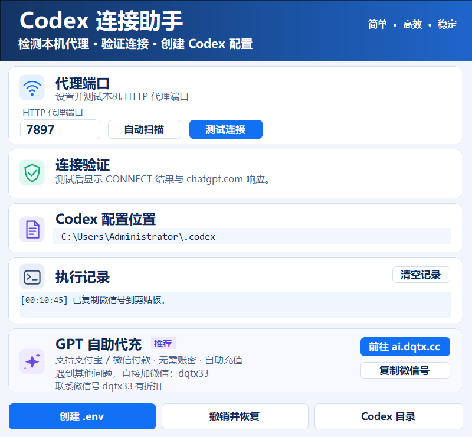

# Codex重连5/5修复助手

检测本机 HTTP 代理、验证连接，并为 Codex 创建可撤销的 `.env` 代理配置。

这是一个使用 C# / WinForms 开发的 Windows 小工具，适合排查代理配置引起的 Codex 重连问题。当前版本：**1.0.9**。

[下载 Windows 程序](https://github.com/dqtx760/codex-reconnect-fix/releases/latest/download/CodexReconnectTool.exe) · [完整下载页](https://github.com/dqtx760/codex-reconnect-fix/releases/latest)



## 下载与使用

下载适用于 Windows x64 的 EXE，或下载压缩包后解压运行。发布程序已包含 .NET 运行时，使用者无需另外安装 .NET。

1. 启动自己的代理软件。
2. 打开 `CodexReconnectTool.exe`，点击“自动扫描”，或手动输入本机 HTTP 代理端口。
3. 点击“测试连接”，查看代理验证与 `chatgpt.com` 响应结果。
4. 点击“创建 .env”，将通过验证的代理端口写入 Codex 配置目录。
5. 手动完全关闭 Codex，从自己原来的安装入口重新打开，再新建对话验证。

底部提供“创建 .env”“撤销并恢复”“Codex 目录”三个入口。软件不自动关闭或启动 Codex，可以配合客户原有的安装入口使用。

## 主要功能

- **代理发现**：读取代理环境变量、Windows 系统代理、Codex `.env`，并检查常见端口与本机回环监听端口。
- **连接验证**：检测代理是否返回 `CONNECT 200`，并通过该代理请求 `https://chatgpt.com/`。
- **专属配置**：把代理设置写入 Codex 配置目录的 `.env`，不修改 Windows 用户或系统环境变量。
- **备份与恢复**：首次应用前备份已有 `.env`；撤销时恢复原文件。若文件在修复后被再次编辑，会先要求确认。
- **目录识别**：默认使用当前 Windows 用户的 `%USERPROFILE%\.codex`；若已设置 `CODEX_HOME`，则使用指定目录。
- **运行反馈**：显示执行记录，支持清空记录；扫描或测试后显示对应结果。

## 写入的配置

例如输入端口 `7897` 时，会写入以下三项：

```dotenv
HTTP_PROXY=http://127.0.0.1:7897
HTTPS_PROXY=http://127.0.0.1:7897
NO_PROXY=localhost,127.0.0.1,::1
```

更新前会整理已有的 `HTTP_PROXY`、`HTTPS_PROXY`、`ALL_PROXY`、`NO_PROXY`、`WS_PROXY`、`WSS_PROXY` 项，保留 `.env` 中其他配置，再写入以上三项。

备份与撤销记录保存在同一个 Codex 配置目录中：

- 已有配置的备份：`.env.codex-reconnect-时间戳.bak`。
- 撤销记录：`.codex-reconnect-fix.state.json`。
- 原先没有 `.env` 时，撤销会移除本工具创建的 `.env`。

## 使用范围

- 当前检测与配置的是 `127.0.0.1` 上的 HTTP 代理，不支持只提供 SOCKS 的端口，也不处理需要用户名和密码认证的代理。
- `CONNECT 200` 表示代理通道已建立；收到网站 HTTP 响应不代表账号登录、订阅或完整功能已经正常。
- 工具用于处理代理配置问题，不能保证解决所有重连原因。
- 本项目是第三方配置辅助工具，不是 OpenAI 官方软件。
- 软件不收集分析数据。连接检测会访问 `chatgpt.com`；推广链接在点击后由默认浏览器打开。
- 当前发布的程序未包含发布者数字签名。

## 从源码编译

准备 Windows、.NET 10 SDK 和 PowerShell 5.1 或更高版本。在项目根目录执行：

```powershell
powershell.exe -NoProfile -ExecutionPolicy Bypass -File .\build.ps1
```

生成文件：

```text
dist/
├─ win-x64/
│  ├─ CodexReconnectTool.exe
│  ├─ README.md
│  └─ LICENSE
├─ CodexReconnectTool-1.0.9-win-x64.zip
└─ SHA256SUMS.txt
```

也可以直接执行单文件发布命令：

```powershell
dotnet publish .\CodexReconnectTool.csproj -c Release -r win-x64 --self-contained true `
  -p:PublishSingleFile=true -p:IncludeNativeLibrariesForSelfExtract=true `
  -p:EnableCompressionInSingleFile=true -o .\dist\win-x64
```

源码与文档通过 Git 管理；`bin`、`obj`、`dist` 及本机配置已加入忽略规则。编译后的程序通过 [Releases](https://github.com/dqtx760/codex-reconnect-fix/releases) 提供下载。

## 项目文件

| 文件 | 用途 |
| --- | --- |
| `MainForm.cs` | 窗口、界面绘制和按钮操作 |
| `ProxyService.cs` | 代理端口发现与连接检测 |
| `EnvConfigStore.cs` | `.env` 写入、备份和撤销 |
| `Program.cs` | 程序入口 |
| `CodexReconnectTool.csproj` | .NET 项目与版本配置 |
| `app.ico` / `app.manifest` | 应用图标与 Windows 清单 |
| `build.ps1` | 编译、打包与 SHA256 校验文件生成 |
| `PRODUCT.md` | 产品与界面设计约定 |

## 推广与联系

软件界面保留 GPT 自助代充推广入口：[ai.dqtx.cc](https://ai.dqtx.cc)。支持支付宝 / 微信付款，无需账密，自助充值。

遇到其他问题可添加微信：**dqtx33**。点击“复制微信号”会复制 `dqtx33`，并显示“联系微信号 dqtx33 有折扣”。入口地址和微信号位于 `MainForm.cs` 的 `ServiceUrl` 与 `WeChatId` 常量。

## 开源许可

本项目采用 [MIT 许可证](LICENSE)。
